<p align="center">
  
</p>

<h1 align="center">AgroESP32</h1>

<p align="center">
  <b>Red de sensores agrícolas de largo alcance:</b> nodos LoRa 915 MHz sobre una PCB de diseño propio,<br>
  un gateway WiFi y una plataforma web en la nube para monitorear y actuar sobre un cultivo a distancia.
</p>

<p align="center">
  
  
  
  
  
  
  
</p>

<p align="center">
  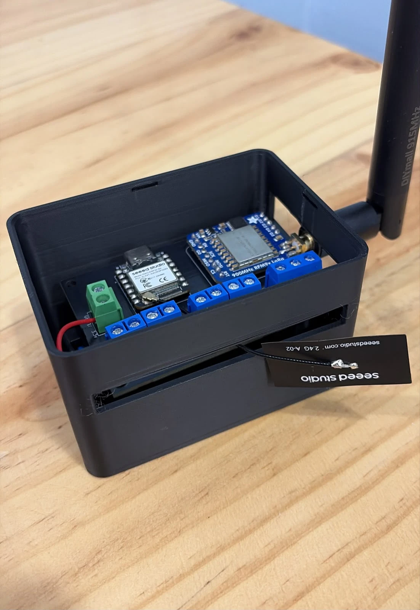
  <br>
  <sub>Prototipo armado: PCB propia con el XIAO ESP32-S3 y el RFM95W, antena de 915 MHz y carcasa impresa en 3D</sub>
</p>

> **Hardware diseñado por mí.** La PCB del nodo (esquemático, ruteo, Gerbers y BOM) la diseñé en KiCad 10: un carrier de 75 × 51 mm para el Seeed XIAO ESP32-S3 y un módulo LoRa RFM95W, con borneras para conectar sensores y actuadores en campo sin soldar. Los archivos fuente están en [`hardware/`](hardware/).

---

## Contenido

- [El problema](#el-problema)
- [Resultados](#resultados)
- [Arquitectura](#arquitectura)
- [Hardware](#hardware)
  - [PCB del nodo XIAO (diseño propio)](#pcb-del-nodo-xiao-diseño-propio)
  - [Esquemático y mapa de conexiones](#esquemático-y-mapa-de-conexiones)
  - [BOM](#bom)
  - [Del diseño al nodo en campo](#del-diseño-al-nodo-en-campo)
  - [Nodo ESP32 DOIT y gateway](#nodo-esp32-doit-y-gateway)
- [Firmware](#firmware)
- [Plataforma web](#plataforma-web)
- [Pruebas de alcance](#pruebas-de-alcance)
- [Problemas de ingeniería resueltos](#problemas-de-ingeniería-resueltos)
- [Qué demuestra este proyecto](#qué-demuestra-este-proyecto)
- [Estructura del repositorio](#estructura-del-repositorio)
- [Compilar y flashear](#compilar-y-flashear)
- [Próximos pasos](#próximos-pasos)

---

## El problema

Monitorear un cultivo normalmente obliga a ir hasta el terreno. Las zonas rurales suelen no tener WiFi, cobertura celular ni tomas de corriente cerca, y las soluciones IoT comerciales son caras y dependen de suscripciones.

AgroESP32 resuelve eso con radio **LoRa a 915 MHz** (banda ISM, sin licencia): nodos de bajo consumo miden el ambiente en el cultivo y transmiten a un gateway que sí tiene internet. Desde un panel web se ven los datos en tiempo real y se mandan órdenes de vuelta a los nodos, incluida la activación de una **bomba de agua** a través de un relé de estado sólido.

## Resultados

| | |
|---|---|
| **594,66 m** | enlace más largo con recepción confirmada, sin línea de vista (edificios densos y bosque) |
| **−38 a −100 dBm** | rango de RSSI registrado en la plataforma |
| **500 lecturas** | recibidas en prueba continua con intervalo de 1 min |
| **3 tipos de nodo** | emisor XIAO (PCB propia), emisor ESP32 DOIT multi-sensor y gateway |
| **75 × 51 mm** | PCB de 2 capas, solo componentes THT, sin vías |
| **Lazo cerrado** | la plataforma no solo lee: enciende y apaga una bomba vía `set_relay` |

## Arquitectura

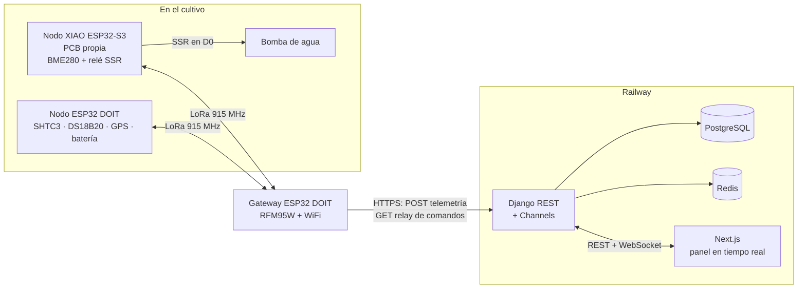

La telemetría sube como JSON por LoRa. El gateway le agrega el RSSI real del paquete y la publica en la API. Los comandos hacen el camino inverso: el gateway consulta si hay órdenes pendientes para ese nodo y las retransmite durante una ventana de escucha que el nodo abre después de cada transmisión. El gateway no necesita saber qué hardware tiene cada nodo; enruta todo por `device_id`.

<details>
<summary><b>Diagramas del documento de diseño</b></summary>
<br>

**Diagrama de contexto**

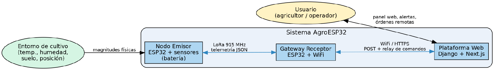

**Diagrama de bloques**

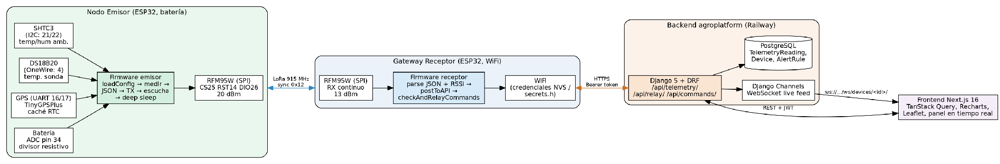

Ambos corresponden a la fase de diseño, con el nodo ESP32 DOIT como emisor de referencia. El documento completo está en [`docs/DISENO.md`](docs/DISENO.md).

</details>

---

## Hardware

### PCB del nodo XIAO (diseño propio)

<table>
  <tr>
    <td width="50%">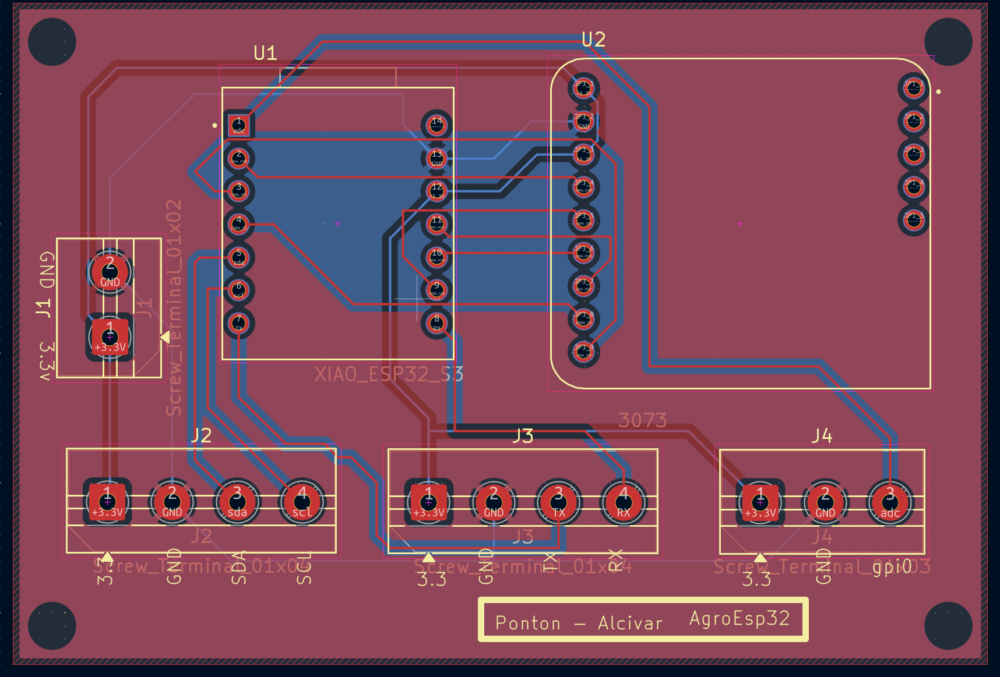</td>
    <td width="50%">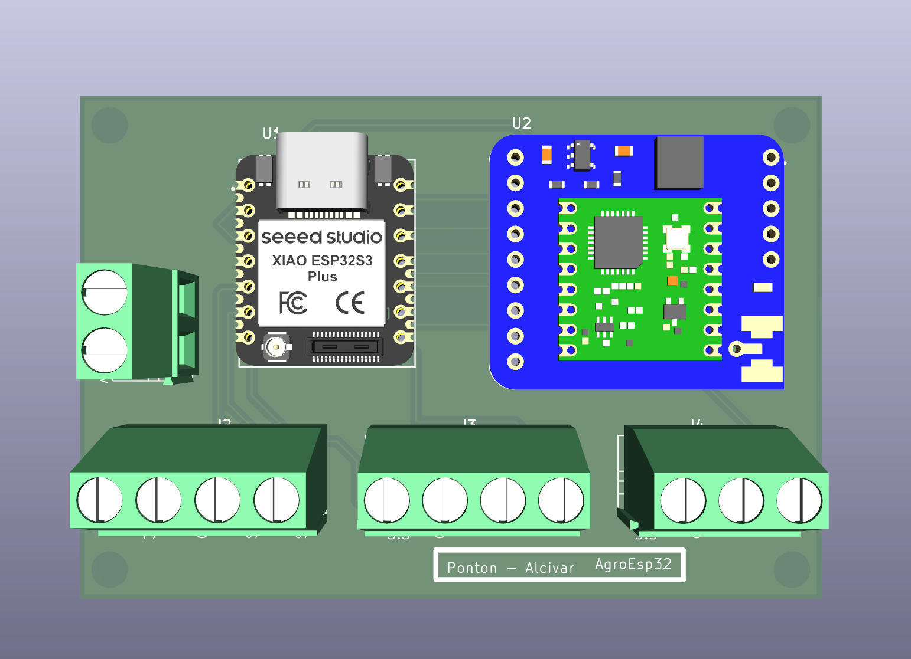</td>
  </tr>
  <tr>
    <td align="center"><sub>Layout en KiCad: F.Cu (rojo) y B.Cu (azul), plano de GND en ambas caras</sub></td>
    <td align="center"><sub>Vista 3D superior con los módulos montados</sub></td>
  </tr>
  <tr>
    <td width="50%">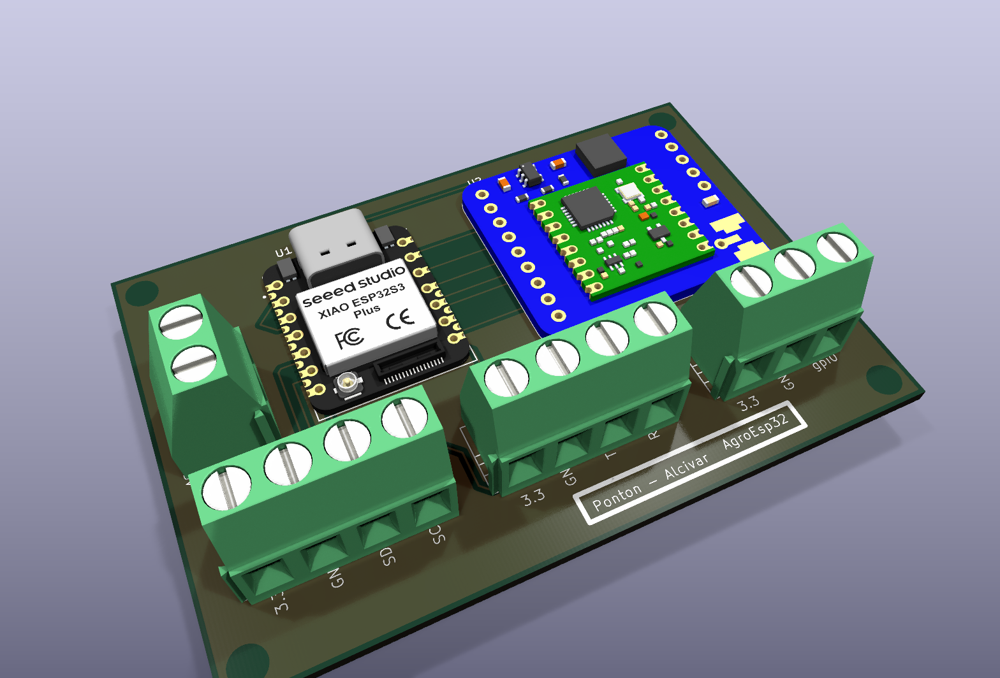</td>
    <td width="50%">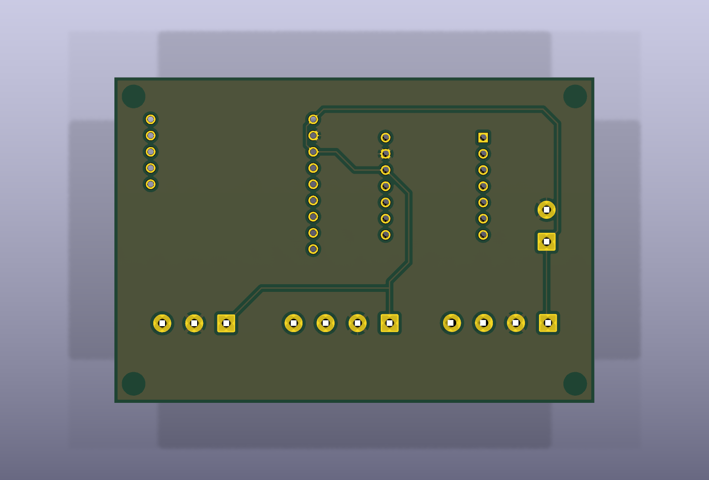</td>
  </tr>
  <tr>
    <td align="center"><sub>Render isométrico</sub></td>
    <td align="center"><sub>Cara inferior (B.Cu)</sub></td>
  </tr>
</table>

**Especificaciones**

| Parámetro | Valor |
|---|---|
| Herramienta | KiCad 10 (esquemático + PCB + render 3D) |
| Dimensiones | 75 × 51 mm |
| Capas | 2 (F.Cu / B.Cu), FR-4 de 1,6 mm |
| Ancho de pista | 0,2 mm en todas las señales |
| Planos de cobre | GND en ambas caras |
| Vías | 0: todo el ruteo se resolvió en dos capas sin vías |
| Montaje | 100 % THT, soldable a mano sin equipo de SMD |
| Fijación | 4 agujeros de montaje en las esquinas |
| Conectores de campo | borneras de tornillo de 5,00 mm (MaiXu MX126) |

**Decisiones de diseño**

- **Módulos enchufables en vez de chips sueltos.** El XIAO ESP32-S3 y el breakout del RFM95W van montados como módulos. Si uno falla en campo se reemplaza sin desoldar, y la placa queda simple de fabricar y ensamblar.
- **Un puerto por bus.** Cada bornera expone una interfaz completa con su propio 3,3 V y GND, así cualquier sensor se conecta con un destornillador:
  - **J1:** entrada de alimentación (3,3 V / GND)
  - **J2:** I2C (3,3 V, GND, SDA, SCL), hoy el BME280
  - **J3:** UART (3,3 V, GND, TX, RX), reservado para un GPS
  - **J4:** GPIO/ADC (3,3 V, GND, D0), hoy maneja el relé SSR; como D0 es el único pin libre con ADC, también sirve para medir batería
- **SPI por hardware.** El RFM95W usa los pines SPI nativos del XIAO (D8, D9, D10), y CS, RST y DIO0 van a GPIO de propósito general.
- **Radio siempre habilitada.** El pin `EN` del breakout está atado a 3,3 V, y el pin de 5 V del XIAO queda sin conectar a propósito para que toda la placa trabaje en un único riel de 3,3 V.
- **Pistas cortas al módulo de radio.** El RFM95W queda al lado del XIAO para acortar las líneas SPI, con planos de GND como referencia de retorno.

### Esquemático y mapa de conexiones

<p align="center">
  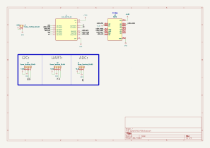
</p>

También en PDF: [`hardware/esquematico.pdf`](hardware/esquematico.pdf).

Mapa de conexiones, extraído de la netlist del esquemático:

| Pin XIAO | GPIO | Red | Destino |
|---|---|---|---|
| D0 | GPIO1 | `adc` | J4-3 (GPIO/ADC → relé SSR) |
| D1 | GPIO2 | `LORA_DIO0` | U2 G0 |
| D2 | GPIO3 | `LORA_RST` | U2 RST |
| D3 | GPIO4 | `LORA_CS` | U2 CS |
| D4 | GPIO5 | `sda` | J2-3 |
| D5 | GPIO6 | `scl` | J2-4 |
| D6 | GPIO43 | `TX` | J3-3 |
| D7 | GPIO44 | `RX` | J3-4 |
| D8 | GPIO7 | `LORA_SCK` | U2 SCK |
| D9 | GPIO8 | `LORA_MISO` | U2 MISO |
| D10 | GPIO9 | `LORA_MOSI` | U2 MOSI |
| 3V3 | — | `+3.3V` | J1–J4 pin 1, U2 VIN, U2 EN |
| GND | — | `GND` | J1–J4 pin 2, U2 GND |
| 5V | — | sin conectar | — |

> En la PCB, `DIO0` y `RST` del RFM95W quedaron en D1 y D2 respectivamente, al revés que en el primer prototipo en protoboard (RST en D1, DIO0 en D2). Hay que tenerlo en cuenta al configurar `LORA_RST_PIN` y `LORA_DIO0_PIN` en `src/emisor_xiao/board_config.h`.

### BOM

**Componentes de la PCB** (exportado de KiCad: [`hardware/BOM.csv`](hardware/BOM.csv))

| Ref | Cant. | Componente | Función | Huella |
|---|---|---|---|---|
| U1 | 1 | Seeed Studio XIAO ESP32-S3 Plus | MCU: ESP32-S3, WiFi + BLE, USB-C, carga de LiPo integrada | `XIAO_ESP32_S3:MODULE_XIAO_ESP32_S3` |
| U2 | 1 | Adafruit RFM95W LoRa breakout, 915 MHz | Transceptor LoRa (SX1276) por SPI | `3073:MODULE_3073` |
| J1 | 1 | Bornera 2 pines, paso 5,00 mm (MaiXu MX126-5.0-02P) | Entrada de alimentación 3,3 V | `TerminalBlock_MaiXu_MX126-5.0-02P_1x02_P5.00mm` |
| J2, J3 | 2 | Bornera 4 pines, paso 5,00 mm (MaiXu MX126-5.0-04P) | Puertos I2C y UART | `TerminalBlock_MaiXu_MX126-5.0-04P_1x04_P5.00mm` |
| J4 | 1 | Bornera 3 pines, paso 5,00 mm (MaiXu MX126-5.0-03P) | Puerto GPIO/ADC | `TerminalBlock_MaiXu_MX126-5.0-03P_1x03_P5.00mm` |
| — | 1 | PCB 75 × 51 mm, 2 capas, FR-4 1,6 mm | Placa base | [`hardware/fabricacion/`](hardware/fabricacion/) |

> La huella de U2 es la de Adafruit 3073 (RFM96W, 433 MHz), que comparte contorno y pinout con la versión de 915 MHz (Adafruit 3072). En la placa va montada la de **915 MHz**.

**Componentes externos del nodo** (conectados por bornera o al XIAO)

| Componente | Cant. | Conexión | Función |
|---|---|---|---|
| BME280 breakout (I2C, 0x76/0x77) | 1 | J2 | Temperatura, humedad y presión atmosférica |
| Módulo relé de estado sólido (SSR) | 1 | J4 (D0) | Encendido de la bomba de agua |
| Bomba de agua | 1 | Salida del SSR | Actuador de riego |
| Antena 915 MHz con conector SMA (DIYmall) | 1 | Breakout RFM95W | Enlace LoRa |
| Antena 2,4 GHz u.FL (incluida con el XIAO) | 1 | XIAO ESP32-S3 | WiFi / BLE |
| Batería LiPo 3,7 V, 1 celda | 1 | Conector `BAT` del XIAO | Alimentación autónoma, se carga por USB-C |
| Carcasa impresa en 3D | 1 | — | Encapsulado del nodo para campo |

### Del diseño al nodo en campo

<p align="center">
  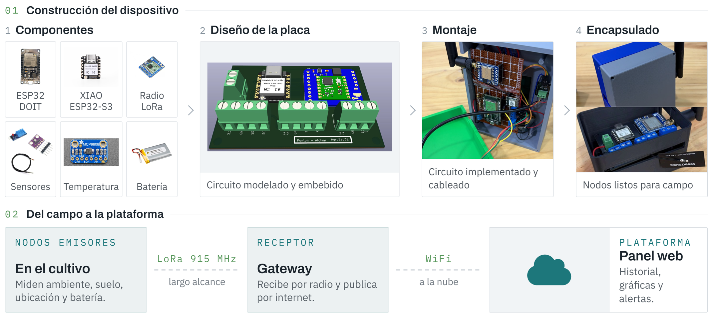
</p>

El proceso: selección de componentes, diseño de la placa en KiCad, montaje y cableado del circuito, y encapsulado de los nodos para llevarlos al campo.

### Nodo ESP32 DOIT y gateway

Además del nodo XIAO, el sistema tiene dos equipos sobre **ESP32 DOIT DevKit V1**:

**Nodo emisor multi-sensor**

| Señal | GPIO |
|---|---|
| RFM95W: CS / RST / DIO0 | 25 / 14 / 26 |
| RFM95W: SCK / MISO / MOSI | 18 / 19 / 23 |
| SHTC3 (I2C): SDA / SCL | 21 / 22 |
| DS18B20 (OneWire, pull-up 4,7 kΩ) | 4 |
| GPS (UART): RX / TX | 16 / 17 |
| Batería (ADC, divisor 1:1) | 34 |

**Gateway receptor:** mismo módulo RFM95W y mismos pines de radio, en recepción continua por interrupción. Usa el WiFi del ESP32 para publicar en la nube y transmite a 13 dBm (los emisores, a 20 dBm).

**Perfil de radio común**

| Parámetro | Valor |
|---|---|
| Frecuencia | 915,0 MHz (ISM) |
| Spreading factor / ancho de banda | SF7 / 125 kHz |
| Coding rate | 4/5 |
| Sync word | `0x12` (red privada) |
| Payload máximo | 250 bytes |

---

## Firmware

Un solo proyecto **PlatformIO** (C++ / Arduino) con un entorno por equipo:

| Entorno | Placa | Rol |
|---|---|---|
| `emisor` | ESP32 DOIT DevKit V1 | Nodo multi-sensor: SHTC3, DS18B20, GPS, batería |
| `emisor_xiao` | Seeed XIAO ESP32-S3 | Nodo de la PCB: BME280 + relé SSR |
| `receptor` | ESP32 DOIT DevKit V1 | Gateway LoRa → WiFi → API |

**Características**

- **RadioLib** sobre el SX1276. TX y RX bloqueantes leyendo el pin de IRQ, sin acceso SPI dentro de interrupciones (ver [problemas resueltos](#problemas-de-ingeniería-resueltos)).
- **Configuración en tres niveles:** NVS (`Preferences`) → `secrets.h` generado por la plataforma → modo *provisioning* que espera un JSON por serial. Las credenciales nunca se versionan.
- **Payload JSON adaptativo:** si el paquete supera 250 bytes, el nodo DOIT recorta el bloque GPS por niveles (todo → sin altitud/velocidad/HDOP → solo lat/lon → sin GPS).
- **Comandos remotos** recibidos en una ventana de escucha de 7 s después de cada TX y persistidos en NVS:

| Comando | Parámetros | Efecto |
|---|---|---|
| `set_sleep` | `{"minutes": N}` | Cambia el intervalo de envío (1–1440 min) |
| `enable_sensor` | `{"sensor": "...", "enable": bool}` | Activa o desactiva un sensor (nodo DOIT) |
| `set_relay` | `{"state": bool}` | Enciende o apaga el relé SSR (nodo XIAO); el estado sobrevive a reinicios |
| `set_device_id` | `{"device_id": "..."}` | Reasigna el ID y reinicia |
| `restart` | `{}` | Reinicio por software |

**Ejemplo de payload del nodo XIAO**

```json
{
  "device_id": "e2",
  "amb": { "ok": true, "temp_c": 24.8, "hum_pct": 52.3, "pressure_hpa": 1013.2 },
  "relay": { "on": false },
  "rssi": -38
}
```

`rssi` lo agrega el gateway con la medición real del paquete recibido.

**Ciclo de vida del nodo (diseño)**

<p align="center">
  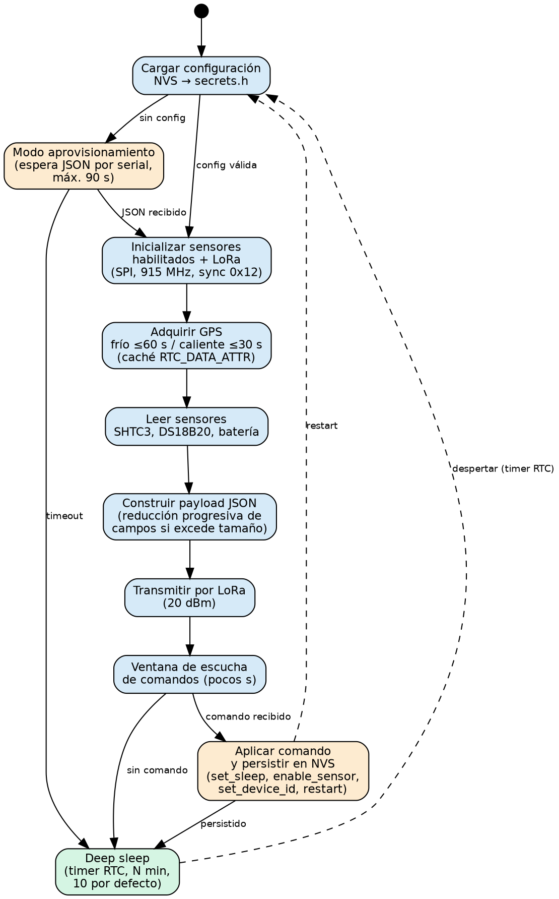
</p>

El diseño contempla *deep sleep* entre ciclos con caché del GPS en memoria RTC (arranque en caliente ≤ 30 s contra 60 s en frío). Los builds de prueba transmiten cada ~10 s para iterar rápido sobre el enlace.

---

## Plataforma web

Código en el repositorio [**AgroPlatfrom**](https://github.com/diegoPonton/AgroPlatfrom), desplegado en Railway con auto-deploy desde `main`.

<p align="center">
  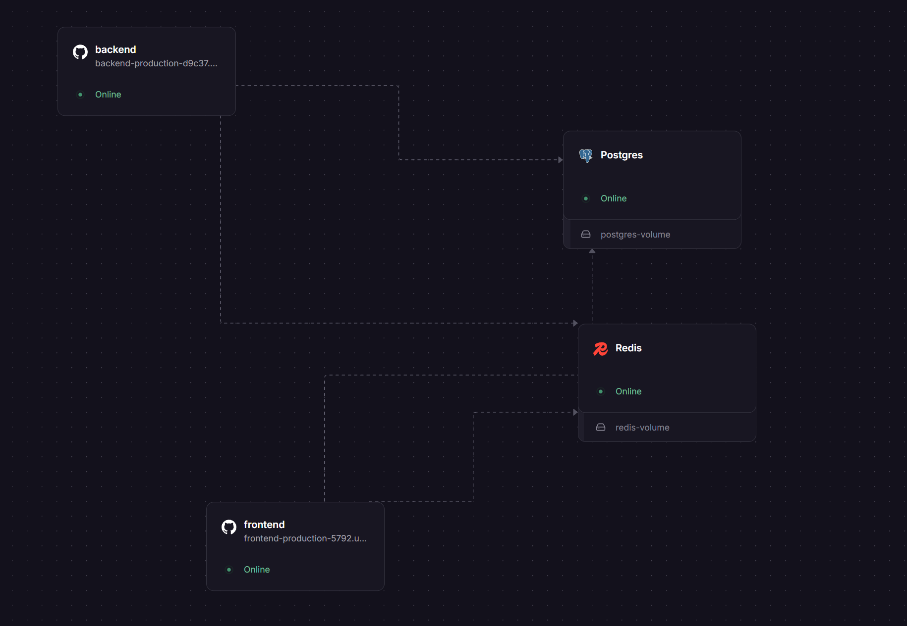
</p>

| Capa | Tecnología |
|---|---|
| Backend | Django 5, Django REST Framework, Django Channels (WebSocket) |
| Datos | PostgreSQL, Redis como channel layer |
| Frontend | Next.js (App Router), TanStack Query, Recharts, Leaflet, shadcn/ui |
| Infraestructura | Railway: 4 servicios, migraciones automáticas en cada deploy |

**Funcionalidades**

- Autenticación JWT y organizaciones multi-usuario.
- Registro de nodos y asignación de cada emisor a su gateway.
- Ingesta de telemetría autenticada con el token del gateway; cada lectura guarda qué gateway la recibió.
- Panel en tiempo real por WebSocket: KPIs, historial graficado, RSSI y mapa GPS.
- Cola de comandos con estados (`pending` → `relayed` → `acked`) retransmitidos por el gateway.
- Generación de `secrets.h` por dispositivo y **flasheo de firmware desde el navegador** (Web Serial + esptool-js).

---

## Pruebas de alcance

<p align="center">
  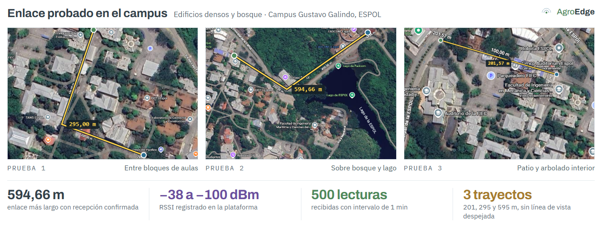
</p>

El enlace se probó en un campus universitario con edificios densos, arbolado y un lago, **sin línea de vista despejada** en ninguno de los tres trayectos:

| Prueba | Trayecto | Distancia | Resultado |
|---|---|---|---|
| 1 | Entre bloques de aulas | 295,00 m | Recepción confirmada |
| 2 | Sobre bosque y lago | **594,66 m** | Recepción confirmada (enlace más largo) |
| 3 | Patio y arbolado interior | 201,57 m | Recepción confirmada |

Durante las pruebas la plataforma registró 500 lecturas con intervalo de 1 minuto y RSSI entre −38 y −100 dBm. Con línea de vista, LoRa a SF7 alcanza bastante más; estas cifras son el peor caso urbano.

---

## Problemas de ingeniería resueltos

Una parte importante del proyecto fue depurar hardware real:

- **Sensor mal identificado.** Una placa vendida como "GY-39" se trató primero como BME280 y nunca respondió. Al revisar el hardware resultó ser un módulo 4 en 1 con un **SPL06-007** para presión, cuyos registros no coinciden con los del BME280. La solución fue leer directamente el **SHTC3** que la misma placa expone en I2C (`0x70`), y usar un BME280 genuino en el nodo XIAO.
- **TX colgado con RadioHead.** Después de esperar ~60 s el fix del GPS, el SX1276 no volvía a STANDBY y cada transmisión daba timeout (`IRQ_FLAGS = 0x00`, nunca `TxDone`). Además, acceder a SPI dentro de la ISR de DIO0 provocaba reinicios. Migrar a **RadioLib** con TX/RX bloqueantes por sondeo del pin IRQ eliminó ambos problemas.
- **Pines intercambiados entre prototipo y PCB.** En la placa propia, RST y DIO0 del RFM95W quedaron en pines distintos a los del prototipo en protoboard, así que la asignación de pines del prototipo no servía para la placa. Se corrigió reasignando los pines en el firmware, sin rehacer la PCB.
- **404 en la ingesta.** Al sumar un nodo nuevo, la API devolvía 404. No era un bug: el backend solo acepta telemetría de dispositivos registrados en la misma organización que el gateway, una restricción de seguridad multi-tenant intencional.

## Qué demuestra este proyecto

| Área | Habilidades |
|---|---|
| **Diseño de hardware** | Captura de esquemático, ruteo de PCB de 2 capas, planos de GND, generación de Gerbers y BOM en KiCad; selección de componentes; montaje y depuración con multímetro |
| **Sistemas embebidos** | ESP32 / ESP32-S3, buses SPI, I2C, UART, OneWire y ADC; NVS; manejo de interrupciones; gestión de energía |
| **Radiofrecuencia** | Configuración de LoRa (SF, BW, CR, sync word), pruebas de alcance en campo, análisis de RSSI |
| **Firmware** | C++ / Arduino con PlatformIO, protocolo propio sobre LoRa, comandos remotos con persistencia, aprovisionamiento seguro de credenciales |
| **Backend y cloud** | Django REST, WebSocket con Channels, PostgreSQL, Redis, despliegue continuo en Railway |
| **Frontend** | Next.js, visualización en tiempo real, Web Serial API para flashear dispositivos desde el navegador |

---

## Estructura del repositorio

```
agroESP32_firmware/
├── hardware/
│   ├── kicad/                  # Proyecto KiCad 10 (esquemático + PCB)
│   ├── fabricacion/            # Gerbers + taladros listos para enviar a fabricar
│   ├── BOM.csv                 # Lista de materiales exportada de KiCad
│   └── esquematico.pdf
├── src/
│   ├── emisor/                 # Nodo ESP32 DOIT multi-sensor
│   ├── emisor_xiao/            # Nodo XIAO ESP32-S3 (PCB propia)
│   └── receptor/               # Gateway LoRa → WiFi
├── docs/
│   ├── DISENO.md               # Documento de diseño (alcance, diagramas, plan de pruebas, referencias)
│   ├── RESUMEN_TECNICO.md      # Estado técnico detallado y bitácora de decisiones
│   └── images/
└── platformio.ini
```

Los modelos 3D STEP del XIAO y del breakout de Adafruit son de terceros y no se incluyen. Para el render 3D en KiCad, descargalos de Seeed Studio y Adafruit y colocalos en `hardware/kicad/3dModels/`.

## Compilar y flashear

Requiere [PlatformIO](https://platformio.org/).

```bash
git clone https://github.com/diegoPonton/agroESP32_firmware.git
cd agroESP32_firmware

# Cada equipo necesita su secrets.h (no versionado)
cp src/emisor_xiao/secrets.h.example src/emisor_xiao/secrets.h

pio run -e emisor_xiao -t upload --upload-port COMx
pio device monitor -e emisor_xiao -p COMx
```

Lo mismo aplica para `emisor` y `receptor`. Sin `secrets.h`, el equipo arranca en modo provisioning y espera su configuración por serial.

Para fabricar la placa, subí [`hardware/fabricacion/agroESP32_PCB_gerbers.zip`](hardware/fabricacion/agroESP32_PCB_gerbers.zip) a cualquier fabricante de PCB (2 capas, 1,6 mm).

## Próximos pasos

- **Riego automático:** usar las lecturas de temperatura y humedad (déficit de presión de vapor) para decidir cuándo encender la bomba con `set_relay`, cerrando el lazo sin intervención humana.
- *Deep sleep* en los builds de campo para llevar la autonomía a meses.
- Cifrado AES del enlace LoRa.
- Medición de batería en el nodo XIAO por D0 (ADC) con divisor resistivo.
- Carcasa sellada para intemperie.
- Flasheo del nodo XIAO desde la plataforma web.

---

## Autor

**Diego Pontón Vaca**: diseño de PCB, firmware y plataforma web.

Documentación completa del diseño: [`docs/DISENO.md`](docs/DISENO.md) · Estado técnico detallado: [`docs/RESUMEN_TECNICO.md`](docs/RESUMEN_TECNICO.md)
