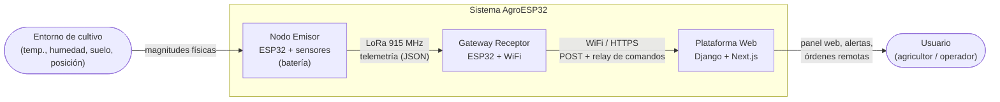
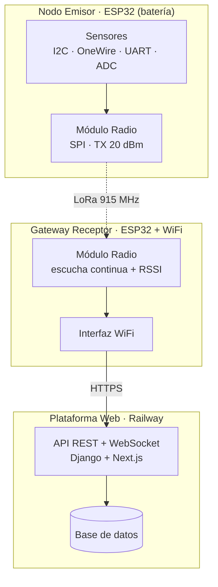
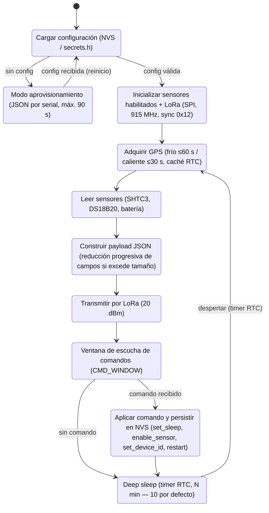

# Documento de Diseño

## AgroEdge: monitoreo agrícola remoto de largo alcance con LoRa

**Autores:** Diego Pontón Vaca, Lizbeth Alcívar Macías — Julio 2026

---

## 1. Introducción

AgroESP32 nace de un problema concreto: monitorear un cultivo suele exigir ir hasta el terreno, que muchas veces no tiene WiFi ni corriente cerca. La propuesta es un nodo sensor a batería, basado en ESP32, que mide temperatura y humedad del ambiente, temperatura del suelo con una sonda enterrada (DS18B20), su posición GPS y su batería, y transmite por radio LoRa a 915 MHz. Un segundo ESP32 actúa de gateway: sube los paquetes por WiFi a una plataforma web donde el usuario ve los datos en tiempo real y envía órdenes de vuelta.

El objetivo central del proyecto es *alcanzar la mayor distancia posible manteniendo meses de autonomía a batería*, algo que la literatura respalda: LoRa ha demostrado enlaces de hasta 15 km en tierra con nodos de bajo consumo [1], y las redes LPWAN se consideran la opción natural para agricultura de precisión frente a WiFi o Bluetooth [2][3]. La distancia útil depende del terreno: en campos abiertos con línea de vista el enlace cubre varios kilómetros, mientras que en cultivos altos o vegetación densa se reduce por obstrucción.

## 2. Alcance y Limitaciones

### Alcance

- Firmware para ambos equipos en un mismo proyecto PlatformIO, con entornos `emisor` y `receptor` que comparten la configuración de radio, con deep sleep configurable (10 min por defecto).
- Enlace LoRa en red privada (sync word) con payload adaptativo, que recorta primero los campos de GPS menos importantes si excede el límite de la radio.
- Plataforma web con autenticación JWT, gestión de dispositivos, generación automática de `secrets.h`, flasheo por USB, telemetría en vivo por WebSocket, y comandos remotos (`set_sleep`, `enable_sensor`, `set_device_id`, `restart`) con persistencia en NVS.
- Arquitectura extensible a red mesh: los nodos pueden operar como relevos intermedios (inundación gestionada, límite de saltos, caché de duplicados) para extender la cobertura más allá de un solo enlace, siguiendo el enfoque validado en [4].

### Limitaciones

En términos generales, el proyecto priorizó validar el enlace de largo alcance y la plataforma de monitoreo, dejando pendientes la seguridad del canal de radio, la protección física del hardware en campo y la facilidad de uso para un operador sin conocimientos técnicos:

- El payload de radio viaja sin cifrar; el aislamiento se apoya en la sync word privada y los identificadores de dispositivo. El cifrado AES queda como trabajo pendiente.
- El motor de alertas está incompleto: existen modelos y endpoints, pero falta la evaluación de reglas y las notificaciones.
- El sistema observa y configura, pero no actúa sobre el cultivo (riego, válvulas), y no hay actualización de firmware por radio.
- El hardware del nodo emisor aún no cuenta con una carcasa sellada; la intemperie expone los componentes a humedad y filtraciones. Se recomienda una carcasa hermética como trabajo futuro.
- La configuración y el monitoreo requieren cierto conocimiento técnico; un usuario sin experiencia podría encontrar compleja la puesta en marcha, limitando la adopción en campo.

## 3. Diagrama de contexto

El sistema tiene dos actores externos: el cultivo, que aporta las magnitudes a medir, y el usuario, que revisa el panel y emite órdenes. Internamente hay tres bloques: el nodo emisor, el gateway (puente entre radio e internet) y la plataforma web. La telemetría sube y los comandos bajan por el gateway.

*Figura 1. Diagrama de contexto del sistema.*

## 4. Diagrama de bloques del Diseño

Cada sensor del nodo emisor se conecta a la ESP32 por su bus natural (I2C, OneWire, UART, ADC), y el módulo de radio se comunica por SPI con una potencia de transmisión de 20 dBm. El gateway usa el mismo microcontrolador y módulo de radio que el emisor: permanece a la escucha de forma continua, mide el RSSI de cada paquete recibido y lo reenvía, junto con ese dato, hacia la plataforma web a través de su interfaz WiFi integrada.

*Figura 2. Diagrama de bloques del sistema completo.*

## 5. Máquina de Estados del firmware del emisor

El emisor gira en el ciclo despertar, medir, transmitir y dormir, patrón estándar en nodos LPWAN [3]. Al arrancar busca configuración en NVS o `secrets.h`, o espera un JSON por serial. El GPS distingue arranque en frío (60 s) de arranque en caliente (≤30 s) mediante una caché en memoria RTC. Tras transmitir escucha un comando breve, lo aplica y lo persiste antes de dormir.

*Figura 3. Ciclo de vida del nodo emisor.*

## 6. Diseño de Interfaces

Hay tres niveles: en *radio* viaja el JSON con el RSSI agregado; en la *red*, el firmware envía la telemetría por HTTP y recibe comandos por el mismo canal, autenticado con un token; el panel del usuario recibe las lecturas en vivo por WebSocket. En lo *físico*, un equipo nuevo se configura por USB. El panel del usuario incluye login, listado y detalle de dispositivos, gráfico histórico, mapa y un asistente de flasheo.

## 7. Alternativas de Diseño

WiFi y Bluetooth quedaban descartados por alcance y consumo; LoRa ofrece kilómetros de alcance a cambio de poca velocidad [1][2]. Frente a LoRaWAN, que exige gateways y servidor de red complejos, se prefirió el enlace directo en red privada, extendiendo la cobertura como red mesh con inundación gestionada (identificador único, caché de duplicados, límite de saltos), que en la literatura multiplica la cobertura de LoRa con bajo consumo [4].

Se prefirió JSON sobre un encoding binario por simplicidad y para reutilizar ArduinoJson, recortando campos de GPS si el tamaño lo exige. En energía se usa deep sleep con caché de GPS en RTC. Las credenciales no van en el código: la plataforma genera un `secrets.h` por equipo y el aprovisionamiento por serial evita recompilar. El channel layer de WebSocket usa Redis en producción y una variante en memoria en desarrollo.

## 8. Plan de Test y Validación

| ID | Caso de prueba | Resultado esperado | Tipo |
|---|---|---|---|
| T1 | Lectura de sensores vs. instrumento de referencia | Error <±0,5 °C y ±3 %HR; voltaje dentro de ±0,05 V | Unitaria |
| T2 | Alcance incremental (100 m–1 km+) hasta perder la señal, con RSSI | Alcance máximo útil; ≥95 % de paquetes a 500 m con línea de vista | Alcance |
| T3 | Emisor → gateway → API → panel web | Lectura visible en menos de 5 s | Sistema |
| T4 | Enviar `set_sleep` y verificar relay, ack y persistencia tras reinicio | Adopta el nuevo intervalo y lo conserva tras el deep sleep | Sistema |
| T5 | Cortar WiFi y luego la API; probar token inválido | Reintentos sin colgarse; rechaza lecturas sin autenticación | Robustez |
| T6 | Medir corriente en deep sleep y arranque en caliente del GPS | Reposo <1 mA; fix ≤30 s; autonomía proyectada de meses | Consumo |
| T7 | Tres nodos A–B–C; A y C fuera de alcance directo | Mensaje de A llega a C vía B, verificado por saltos | Mesh |

**Criterio de aceptación:** en 72 horas continuas, registrar ≥95 % de los ciclos esperados sin intervención manual.

## 9. Consideraciones Éticas

El dato más sensible es la posición GPS; por eso el acceso está restringido por autenticación, el GPS puede apagarse por comando remoto y sus campos son los primeros en recortarse del payload. Las credenciales del hardware son un riesgo si roban un equipo: los tokens son únicos y revocables, y el transporte va sobre HTTPS, quedando pendiente el cifrado del enlace de radio. Se transmite en la banda ISM de 915 MHz verificando la normativa local de potencia. La autonomía larga acerca el monitoreo de precisión a productores pequeños [3], aunque conviene acompañarla de capacitación.

## 10. Referencias

[1] J. Petäjäjärvi, K. Mikhaylov, A. Roivainen, T. Hänninen y M. Pettissalo, "On the coverage of LPWANs: range evaluation and channel attenuation model for LoRa technology", *14th International Conference on ITS Telecommunications (ITST)*, 2015.

[2] M. Centenaro, L. Vangelista, A. Zanella y M. Zorzi, "Long-range communications in unlicensed bands: the rising stars in the IoT and smart city scenarios", *IEEE Wireless Communications*, vol. 23, no. 5, 2016.

[3] H. M. Jawad, R. Nordin, S. K. Gharghan, A. M. Jawad y M. Ismail, "Energy-Efficient Wireless Sensor Networks for Precision Agriculture: A Review", *Sensors*, vol. 17, no. 8, 2017.

[4] H.-C. Lee y K.-H. Ke, "Monitoring of Large-Area IoT Sensors Using a LoRa Wireless Mesh Network System: Design and Evaluation", *IEEE Transactions on Instrumentation and Measurement*, vol. 67, no. 9, 2018.

[5] A. Augustin, J. Yi, T. Clausen y W. M. Townsley, "A Study of LoRa: Long Range & Low Power Networks for the Internet of Things", *Sensors*, vol. 16, no. 9, 2016.

---

> Para el estado operativo actual del firmware (pines reales, entornos de PlatformIO, bitácora de problemas resueltos), ver [`resumen.md`](../resumen.md) en la raíz del repositorio.
